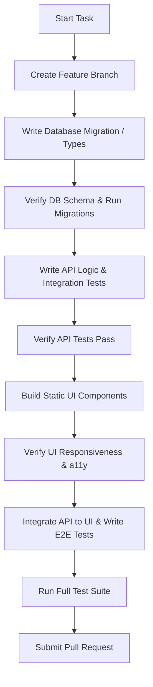

# Incremental Implementation (General Web Apps)

## Overview

Avoid large, monolithic code changes that are difficult to debug, review, and merge. Incremental implementation is the practice of dividing work into small, cohesive, and fully functional changes that can be verified and committed step-by-step.

## When to Use

- Implementing any feature or task from the `planning-task-breakdown` list.
- Performing large refactorings or codebase migrations.
- Working in team environments where small PRs (Pull Requests) are required to avoid merge conflicts.

---

## Guidelines for Incremental Work

### 1. The 100-Line Rule (Concept)
Aim to keep each logical commit or PR focused. While 100 lines is not a hard limit, ask yourself: *Can I split this change into a smaller, logical step that still compiles and passes tests?*

### 2. Red-Green-Refactor Cycle (TDD)
When building functionality:
- **Red**: Write a test for the new behavior and watch it fail.
- **Green**: Write the minimum amount of code to make the test pass.
- **Refactor**: Clean up the code (remove duplication, improve naming) while keeping the tests passing.

### 3. Step-by-Step Feature Implementation Flow

### 4. Continuous Integration & Verification
After every step/task:
- Run linting checks: `npm run lint` or equivalent.
- Run type checks: `npm run typecheck` or `tsc --noEmit`.
- Run unit/integration tests: `npm run test` or `vitest run`.
- **Never commit broken code to the repository branch.** If you need to stop working, commit to a private branch, but keep the main/development branch stable.

---

## Commits & Branch Management

- **Cohesive Commits**: Each commit should represent exactly one change. Avoid mixing database schema changes, UI styling, and unrelated refactoring in one commit.
- **Descriptive Messages**: Follow Conventional Commits:
  - `feat(auth): add JWT login endpoint and validation`
  - `fix(posts): resolve database constraint failure on delete`
  - `test(comments): add integration tests for comment replies`
  - `refactor(db): optimize user query indexing`
- **Feature Flagging**: For large, multi-week features, implement behind feature flags/toggles so code can be safely merged into main without exposing unfinished features to production users.

---

## Verification Checklist

Before marking a task as done:

- [ ] Does the new code compile and build without errors?
- [ ] Have all lint errors and type check warnings been resolved?
- [ ] Are new tests written for both successful paths and error edges?
- [ ] Do all existing and new tests pass locally?
- [ ] Is the git commit message clear and compliant with project standards?
- [ ] Did you clean up any temporary print statements, debuggers, or commented-out code?
