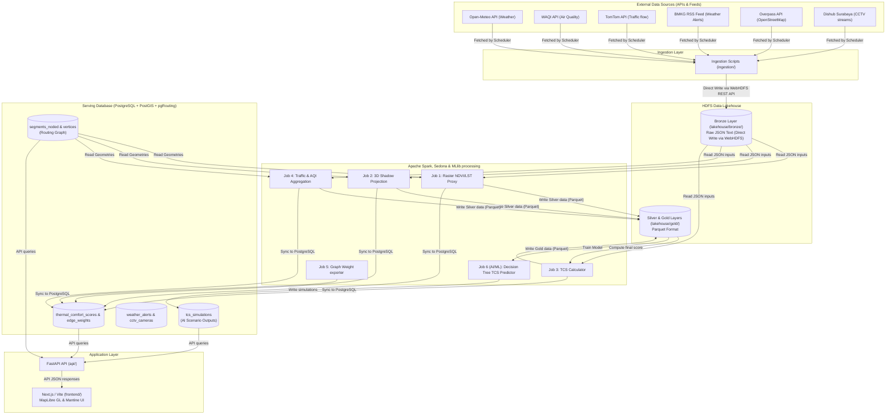

# 🛠️ COMMUTE-COOL — Dokumentasi Arsitektur & Spesifikasi Teknis

Dokumen ini menjelaskan arsitektur *end-to-end* (E2E), detail sumber data, jadwal ingest, pemrosesan data lakehouse (*Medallion Architecture*), alur AI/ML, model relasi database, logika routing pejalan kaki, serta visualisasi peta di platform **COMMUTE-COOL**.

---

## 1. Arsitektur End-to-End (E2E)

Sistem COMMUTE-COOL dibangun menggunakan pola arsitektur **Data Lakehouse** yang memisahkan antara layer penyimpanan data mentah terdistribusi (HDFS), pemrosesan data spasial & AI (Apache Spark, Sedona, & Spark MLlib), penyimpanan relasional-spasial terindeks (PostgreSQL & PostGIS), serta serving layer (FastAPI & Next.js).



---

## 2. Sumber Data & Jadwal Ingest (Scheduler)

Sistem menggunakan [scheduler.py](file:///d:/main-storage/documents/kuliah/sem4/bigdata/fp-dev/ingestion/scheduler.py) yang berbasis `APScheduler` untuk memicu pengambilan data secara berkala. Berbeda dengan arsitektur tradisional, data mentah dari API **langsung ditulis ke HDFS (Bronze Layer) sejak awal** menggunakan WebHDFS REST API tanpa bergantung pada harddisk lokal kontainer.

| Tipe Data | Sumber Data | Parameter | Frekuensi Ingest | Ingestion Target (Direct HDFS Write) | HDFS Path (`lakehouse/bronze/`) |
| :--- | :--- | :--- | :--- | :--- | :--- |
| **Cuaca** | Open-Meteo API | Suhu semu, kelembapan, radiasi matahari | **Setiap 15 Menit** | WebHDFS HTTP API $\rightarrow$ HDFS | `/lakehouse/bronze/weather/` |
| **Lalu Lintas** | TomTom Traffic API | Congestion ratio (kemacetan lokal) | **Setiap 15 Menit** | WebHDFS HTTP API $\rightarrow$ HDFS | `/lakehouse/bronze/traffic/` |
| **Kualitas Udara** | WAQI API | Indeks AQI perkotaan Surabaya | **Setiap 30 Menit** | WebHDFS HTTP API $\rightarrow$ HDFS | `/lakehouse/bronze/aqi/` |
| **Peringatan Cuaca** | BMKG RSS Feed | RSS XML Nowcast Cuaca Buruk | **Setiap 5 Menit** | WebHDFS HTTP API $\rightarrow$ HDFS | `/lakehouse/bronze/alerts/` |
| **Jalan & Infrastruktur**| OSM (Overpass API) | Footway, pedestrian, path, steps, dsb | **Setiap Hari (03:00 WIB)**| PostgreSQL Direct DDL Load | *(Langsung di-load ke PostgreSQL)*|
| **Bangunan & Gedung** | OSM (Overpass API) | Poligon bangunan + tinggi/levels | **Setiap Hari (03:00 WIB)**| PostgreSQL Direct DDL Load | *(Langsung di-load ke PostgreSQL)*|
| **Pepohonan** | OSM (Overpass API) | Koordinat pohon (`natural=tree`) | **Setiap Hari (03:00 WIB)**| PostgreSQL Direct DDL Load | *(Langsung di-load ke PostgreSQL)*|
| **Kamera CCTV** | Dishub Surabaya | Daftar URL streaming HLS | **Setiap Hari (03:45 WIB)**| PostgreSQL Direct DDL Load | *(Langsung di-load ke PostgreSQL)*|

---

## 3. Analisis Medallion Architecture & Direct HDFS Ingestion

Proyek ini sepenuhnya mematuhi konsep **Medallion Architecture (Bronze $\rightarrow$ Silver $\rightarrow$ Gold)** pada Data Lakehouse terdistribusi dengan penulisan langsung (direct write) sejak tahap awal ingestion:

```
           API External Sources (Weather, AQI, Traffic)
                             │
                             ▼ (Direct Write via WebHDFS HTTP PUT)
                    ┌─────────────────┐
                    │   HDFS Bronze   │  <-- Mentah (Raw JSON)
                    └─────────────────┘
                             │
            ┌────────────────┴────────────────┐
            ▼ (Spark Job 1 & 2)               ▼ (Spark Job 4)
  ┌──────────────────┐              ┌──────────────────┐
  │ NDVI/LST Parquet │              │  Traffic Parquet │
  │ (HDFS Gold/Base) │              │ (HDFS Gold/Base) │
  └──────────────────┘              └──────────────────┘
            │                                 │
            └────────────────┬────────────────┘  <-- Data Bersih & Terstruktur per segmen (Konsep Silver)
                             │ (Spark Job 3)
                             ▼
                    ┌─────────────────┐
                    │   HDFS Gold     │  <-- Agregat Bisnis & TCS Final
                    │   TCS Parquet   │
                    └─────────────────┘
                             │ (Spark JDBC Sink / MLlib model training)
            ┌────────────────┴────────────────┐
            ▼                                 ▼
   ┌─────────────────┐               ┌──────────────────┐
   │ PostgreSQL DB   │               │ PySpark MLlib    │  <-- AI/ML Predictor (Job 6)
   │ Serving Layer   │               │ Decision Tree    │
   └─────────────────┘               └──────────────────┘
            │                                 │
            ▼ (Dynamic API Routing)           ▼ (Scenario Simulations)
   ┌─────────────────┐               ┌──────────────────┐
   │ User Web Map    │               │ Govt Dashboard   │  <-- Peta Simulasi &
   │ Navigation      │               │ City Planning    │      Analisis Dampak Hijau
   └─────────────────┘               └──────────────────┘
```

### A. Alur Direct-to-HDFS Ingestion
Ingestion script di dalam folder [ingestion/](file:///d:/main-storage/documents/kuliah/sem4/bigdata/fp-dev/ingestion) memanfaatkan modul `hdfs_client.py` yang menggunakan WebHDFS REST API. Saat scheduler berjalan:
1.  Script melakukan fetch data ke API eksternal.
2.  Data JSON diubah ke dalam bentuk string di memory.
3.  Script mengirim request HTTP PUT langsung ke Hadoop NameNode (`port 9870`).
4.  NameNode me-redirect ke Hadoop DataNode (`port 9864`) dan payload data langsung ditulis ke dalam HDFS (Bronze layer) tanpa disimpan ke harddisk lokal host/kontainer terlebih dahulu.
5.  *Mekanisme Fallback:* Folder local `data/raw/` hanya difungsikan sebagai cadangan jika jaringan atau cluster HDFS mengalami kegagalan (*backup cache*), sehingga menjamin toleransi kesalahan sistem (*fault tolerance*).

### B. Peran Layer Medallion
*   **Bronze Layer (`lakehouse/bronze/`):** Menyimpan mentah data *append-only* JSON.
*   **Silver Layer (Konseptual di `/gold/` & PostGIS):** Data parameter individual per segmen hasil olahan spasial Spark & Sedona (`segment_raster_scores`, `segment_shadows`, `segment_traffic_aqi`).
*   **Gold Layer (`lakehouse/gold/` & PostGIS):** Nilai TCS final (`thermal_comfort_scores`), bobot jalan (`edge_weights`), dan hasil simulasi ML (`tcs_simulations`) untuk konsumsi dashboard dan aplikasi peta.

---

## 4. Alur AI/ML: Decision Tree TCS Predictor & Simulasi Kebijakan

Untuk membantu pemerintah kota dalam mengambil keputusan tata kota (dashboard) dan memberikan prediksi bagi pengguna (peta), COMMUTE-COOL dilengkapi dengan alur **AI/ML** terintegrasi menggunakan **PySpark MLlib** di berkas [job_tcs_predictor.py](file:///d:/main-storage/documents/kuliah/sem4/bigdata/fp-dev/spark_jobs/job_tcs_predictor.py):

### A. Fitur & Target Model
*   **Target Label ($Y$):** `tcs_value` (Thermal Comfort Score aktual per segmen jalan).
*   **Feature Vectors ($X$):**
    1.  `avg_ndvi` (Tingkat kehijauan vegetasi di sekitar segmen).
    2.  `avg_lst` (Suhu permukaan trotoar).
    3.  `avg_shade` (Rasio keteduhan bayangan bangunan/pohon).
    4.  `congestion_ratio` (Kepadatan lalu lintas di samping segmen).
    5.  `aqi_value` (Indeks polusi udara kota).
*   **Algoritma ML:** **Decision Tree Regressor** dari PySpark MLlib (dipilih karena kemampuannya mendeteksi hubungan non-linear spasial dan memberikan signifikansi kepentingan fitur).

### B. Simulasi Skenario Interaktif (Dashboard Pemerintah Kota)
Setelah melatih model ML, Spark memproyeksikan dua skenario intervensi tata kota untuk seluruh segmen jalan pejalan kaki di Surabaya:
1.  **Skenario 1: Green City (Afforestation / Penghijauan Kota)**
    *   **Simulasi:** Menambah kerapatan tajuk pohon (`avg_ndvi` ditingkatkan $+0.25$ secara seragam).
    *   **Tujuan AI:** Memprediksi peningkatan kenyamanan pejalan kaki setelah penanaman pohon baru di area gersang.
2.  **Skenario 2: Cool Pavements (Material Ramah Termal)**
    *   **Simulasi:** Mengurangi penyerapan panas permukaan jalan (`avg_lst` diturunkan $-3.5^\circ\text{C}$ secara seragam).
    *   **Tujuan AI:** Memprediksi dampak penggantian paving aspal hitam menjadi paving blok beton atau rumput.

Keluaran simulasi ini (`predicted_tcs_green`, `predicted_tcs_cool`, dan selisih peningkatannya `tcs_improvement`) ditulis ke dalam tabel PostgreSQL **`tcs_simulations`**.
*   **Manfaat Dashboard:** Dinas Kebersihan dan Ruang Terbuka Hijau (DKRTH) Surabaya dapat langsung mengurutkan jalan mana yang mendapatkan *peningkatan skor kenyamanan paling signifikan (impact factor)* jika ditanami pohon, sehingga alokasi dana APBD penghijauan menjadi sangat presisi berbasis data (*data-driven policy*).

---

## 5. PostgreSQL serving layer & pgRouting Topology

Database PostgreSQL menggunakan extension **PostGIS** dan **pgRouting** untuk menghitung rute pejalan kaki.

### A. Pembuatan Node Topologi Jalan (Routing Fix: Tolerance 0.0005°)
Jalanan mentah dari OpenStreetMap dimuat ke tabel `segments`, lalu diproses menjadi topologi routing melalui fungsi `build_routing_topology()` di berkas [init.sql](file:///d:/main-storage/documents/kuliah/sem4/bigdata/fp-dev/database/init.sql):
1.  **Buat `segments_noded`**: Copy data dari `segments` ke tabel baru untuk diproses pgRouting.
2.  **`pgr_createTopology('segments_noded', 0.0005, 'geom', 'id', ..., clean:=true)`**: Menganalisis geometri jalan, menentukan ID titik pangkal (`source`) dan titik ujung (`target`) pada setiap segmen, serta mengisi tabel indeks titik **`segments_noded_vertices_pgr`**.

> **Catatan Kritis:** Tolerance `0.0005°` (~55 meter) dipakai karena data OSM pedestrian sering memiliki endpoint segmen yang hampir bertemu tapi tidak persis sama. Tolerance yang lebih kecil (`0.0001°`) menghasilkan graph yang terfragmentasi (ratusan komponen terpisah), sehingga routing tidak menemukan jalur dan mengembalikan 0 km.

Endpoint diagnostik & admin tersedia:
- `GET /api/debug/topology-status` — status tabel dan vertex count
- `POST /api/admin/rebuild-topology` — trigger rebuild dari API

### B. Logika API Navigasi Dinamis & Personal Heat Budget
Saat pengguna mencari rute pejalan kaki melalui endpoint FastAPI `POST /api/route` ([navigation.py](file:///d:/main-storage/documents/kuliah/sem4/bigdata/fp-dev/api/routes/navigation.py)):
1.  API mencari ID titik terdekat dari lokasi asal dan tujuan menggunakan koordinat GPS lewat pencarian spasial spatial index `<->`:
    ```sql
    SELECT id FROM segments_noded_vertices_pgr
    ORDER BY the_geom <-> ST_SetSRID(ST_MakePoint(lng, lat), 4326) LIMIT 1;
    ```
2.  API menghitung dua rute menggunakan algoritma Dijkstra bawaan pgRouting (`pgr_dijkstra`):
    *   **Rute Terpendek (Shortest):** Menggunakan biaya murni durasi berjalan kaki standar tanpa memperhitungkan suhu panas:
        $$\text{cost\_sql} = \frac{\text{length\_m}}{1.33\text{ m/s}}$$
    *   **Rute Ternyaman (Most Comfortable):** Menggunakan biaya dinamis dengan penalti kenyamanan termal yang disesuaikan dengan tingkat toleransi panas pengguna:
        $$\text{cost\_sql} = \frac{\text{length\_m}}{1.33\text{ m/s}} \times (1.0 + (1.0 - \text{TCS}) \times \text{multiplier\_toleransi})$$
        *Di mana multiplier toleransi bernilai: Rendah (1.75), Sedang (1.25), Tinggi (0.8).*
3.  **Weather Alert Rerouting:** Jika BMKG mendeteksi adanya cuaca buruk (level *severe/extreme*) di koordinat yang dilewati jalan tersebut, API secara otomatis mengalikan bobot cost segmen tersebut sebesar **100.0x** agar router pgRouting secara agresif memutar jalan menjauhi area bahaya demi keselamatan pejalan kaki.
4.  **Heat Budget validation:** Setelah rute didapatkan, API menghitung total estimasi durasi pejalan kaki terpapar sinar matahari langsung:
    $$\text{Sun Exposure} = \text{durasi perjalanan (menit)} \times (1.0 - \text{rata-rata rasio bayangan})$$
    Jika nilai `Sun Exposure` melebihi limit toleransi pengguna (Low: 8 menit, Medium: 15 menit, High: 25 menit), API menyertakan flag `"within_heat_budget": false` ke frontend agar pejalan kaki diberikan peringatan visual.

---

## 6. Frontend Presentation & Viewport Loading

Frontend Next.js/React memanfaatkan pustaka peta hardware-accelerated **MapLibre GL JS** untuk menampilkan data spasial berukuran besar tanpa menurunkan responsivitas halaman.

1.  **Viewport-based Bounding Box Loading:**
    Alih-alih mengunduh seluruh 105.000 segmen jalan Surabaya sekaligus yang akan membuat browser hang, peta di frontend mendengarkan event pergeseran kamera (`map.on('moveend')`). Setiap kali pengguna menggeser atau memperbesar peta, frontend mengirimkan kueri koordinat layar (*Bounding Box*) ke backend:
    ```
    GET /api/segments/tcs?west=112.72&south=-7.28&east=112.75&north=-7.25
    ```
    PostgreSQL memproses kueri ini secara instan memanfaatkan indeks spasial **GIST** pada kolom geometri segmen jalan (`geom`), dan hanya mengembalikan segmen jalan yang terlihat di layar HP/browser pengguna (maksimal 3000 segmen terdekat).
2.  **TCS Color Visualization (Categorical Grading):**
    Segmen jalan divisualisasikan dengan **4 grade warna kategoris** menggunakan MapLibre GL `step` expression (bukan `interpolate`):
    - 🔴 `< 0.3` → Merah (#e63946) — Sangat Panas
    - 🟠 `0.3–0.5` → Oranye (#f4a261) — Panas
    - 🟡 `0.5–0.7` → Kuning (#e9c46a) — Sedang
    - 🟢 `≥ 0.7` → Hijau (#1a936f) — Nyaman

    Legenda grade TCS ditampilkan di pojok kiri bawah peta navigasi sebagai komponen `TCSLegend.tsx`. Warna TCS dikonsistensikan di seluruh frontend melalui helper functions yang diekspor dari `TCSLegend.tsx` (`tcsToColor`, `tcsToLabel`, `tcsToBadgeColor`).

---

## 7. Interactive Jupyter Notebook (Big Data & ML Pipeline)

Untuk mempermudah dosen penguji atau developer lain menjalankan dan mengeksplorasi kode pemrosesan PySpark & Spark MLlib secara interaktif, berkas **[commute_cool_ml_pipeline.ipynb](file:///d:/main-storage/documents/kuliah/sem4/bigdata/fp-dev/commute_cool_ml_pipeline.ipynb)** telah disediakan di direktori utama proyek.

Notebook ini berisi:
1. Kode inisialisasi PySpark & Apache Sedona.
2. Eksplorasi data HDFS Bronze secara langsung.
3. Contoh kueri Sedona Spatial SQL untuk NDVI/LST & modeling bayangan.
4. Perhitungan TCS formula terbobot.
5. Training model *Decision Tree Regressor* menggunakan Spark MLlib dan eksekusi simulasi skenario kebijakan.
6. Penulisan (sink) ke PostgreSQL DB via JDBC.

